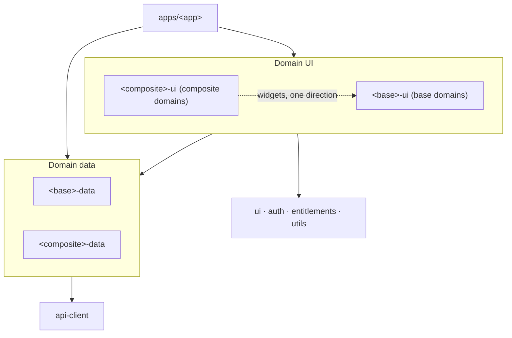

# Frontend Architecture

This document describes how the frontend is structured: how the code is organised, how domain boundaries are enforced, how data crosses between domains, and how routing and navigation work across modules.

## 0. Using this document

This is a template: the rules apply as written, and a project fills in the placeholders below.

| Placeholder | Meaning | Example form |
|---|---|---|
| `<app>` | The deployable app folder under `apps/` | `apps/<app>` |
| `<domain>` | A domain name, kebab-case | `packages/<domain>-data` |
| `<Entity>` / `<entity>` | An entity owned by a domain, PascalCase / kebab-case | `useGet<Entity>`, `src/types/<entity>.ts` |
| `<base>` | A **base domain**: one whose widgets other domains may embed | `@workspace/<base>-ui` |
| `<composite>` | A **composite domain**: one that embeds base domains' widgets | `@workspace/<composite>-ui` |
| `<reference>` | The reference domain new domains copy | `packages/<reference>-data` |

Code snippets use these placeholders as written; they are patterns, not compilable code. Fill in the project's domain table in [section 3](#3-layers-and-boundaries) and the reference implementations table below when adopting the document.

### Reference implementations

The rules below point to a reference for each pattern rather than repeating it. Record the actual path in this project for each one.

| Pattern | Reference in this project |
|---|---|
| Reference domain (package layout, schemas, options and hooks, mutations, mocks) | `packages/<reference>-data`, `packages/<reference>-ui` |
| Query key factory | `packages/<reference>-data/src/keys.ts` |
| Entity schema (attributes, resource, documents, patch) | `packages/<reference>-data/src/types/<entity>.ts` |
| `get<Entity>Options` factory and `useGet<Entity>` hook | `packages/<reference>-data/src/queries/` |
| Optimistic mutation with cache updates | `packages/<reference>-data/src/mutations/` |
| Paged, filtered, sorted infinite list (and its rationale) | `get<Entity>sOptions`, `packages/<domain>-data/CONTEXT.md` |
| List route with typed search params | `apps/<app>/src/routes/_app-shell/_protected/<domain>/route.tsx` |
| Search param schema and URL mapping (unit tested) | `apps/<app>/src/<domain>/<domain>-list-url.ts` |
| Form sheet as a child route | `<domain>/new.tsx`, `<domain>/$<entity>Id/edit.tsx`, `packages/<domain>-ui/CONTEXT.md` |
| Page that surfaces query errors (first page and later pages) | `packages/<domain>-ui/src/pages/` |
| Page-level settling/debounce of user input | `packages/<domain>-ui/src/internal/use-settled-<input>.ts` |
| `@workspace/ui` component that stabilises callbacks | `packages/ui/src/components/<component>/` |
| Main navigation items | `apps/<app>/src/components/nav-items.ts` |

## 1. Summary of the approach

The frontend is a **single deployable React application** composed from **domain packages** in a Turborepo monorepo.

- Each business module is split into two packages owned by the same team: a **data package** (queries, mutations, keys, types) and a **UI package** (pages, widgets).
- A horizontal **API client** package handles transport (and, once the backend publishes a spec, generated backend types).
- The app (`apps/<app>`) assembles everything into one product with a single route tree.
- Routing uses TanStack Router with file-based routes and automatic code splitting, so each module's code is only loaded when the user navigates to it.
- Data fetching uses TanStack Query with a single shared cache across all modules.

When adding a domain, copy the reference domain's package layout, schemas, options and hooks, mutations and mocks. `packages/` is the source of truth for which domains exist.

## 2. Folder structure

```
.
├── apps/
│   └── <app>/                    # The deployable app
│       ├── src/
│       │   ├── routes/           # File-based route tree (thin route files)
│       │   ├── router.ts         # Router creation and type registration
│       │   ├── routeDefaults.tsx # Default route error component
│       │   ├── queryClient.ts    # The single shared QueryClient
│       │   ├── shell/            # createApp (providers) and app chrome (header, sidebar frame)
│       │   ├── components/       # App-level UI: sidebar nav
│       │   ├── mocks/            # MSW worker for `pnpm dev:mock`
│       │   └── main.tsx
│       └── vite.config.ts
│
├── packages/
│   ├── <domain>-data/            # Domain data: one per domain
│   ├── <domain>-ui/              # Domain UI: one per domain
│   │
│   ├── api-client/               # Horizontal: HTTP client, auth headers, query client, mutation helpers
│   ├── ui/                       # Horizontal: design system
│   └── utils/                    # Horizontal: framework-agnostic helpers
│
├── .github/
│   ├── CODEOWNERS
│   └── workflows/ci.yml
├── .dependency-cruiser.cjs
├── biome.json
└── turbo.json
```

### Inside a domain data package

```
packages/<domain>-data/
├── package.json
├── src/
│   ├── index.ts              # Public API — the ONLY entry point other code may import
│   ├── keys.ts               # Query key factory
│   ├── queries/              # `get<Entity>Options` factories and `useGet<Entity>` hooks
│   ├── mutations/            # Mutation hooks, including cache updates
│   ├── types/                # Zod schemas (JSON:API resources) and the inferred domain types
│   ├── mocks/                # MSW handlers and fixtures, exported as `./mocks` (not in index.ts)
│   └── internal/             # Private helpers; API-to-domain mappers only if ever needed
├── turbo.json                # Tags the package `type:data`
└── tsconfig.json
```

`mutations/` and `internal/` are optional: a data package only has them once it writes data or needs private helpers.

### Inside a domain UI package

```
packages/<domain>-ui/
├── package.json
├── src/
│   ├── index.ts              # Public API — the ONLY entry point other code may import
│   ├── pages/                # Full-page components used by route files
│   ├── widgets/              # Small components other domains may embed
│   └── internal/             # Everything else: private to this package
├── turbo.json                # Tags the package `type:ui`
└── tsconfig.json
```

All packages are **internal packages consumed as TypeScript source**, with no separate build step. Each package's `exports` field exposes only `src/index.ts`; data packages add a deliberate `./mocks` entry point (MSW handlers and fixtures) for dev and test tooling, which production code never imports. Because `exports` only exposes these entry points, deep imports such as `@workspace/<domain>-data/src/internal/foo` are rejected by module resolution.

## 3. Layers and boundaries

### Vertical domains

A domain owns a business capability end to end. Each domain is made up of a data package (`<domain>-data`) and a UI package (`<domain>-ui`), both owned by the same team.

Every domain is either a **base domain** or a **composite domain**:

- A **base domain** owns entities that other parts of the product refer to and show (a register, a directory, a catalogue). Its widgets may be embedded elsewhere. It never embeds another domain's UI directly.
- A **composite domain** owns work or processes built on top of base entities. It may embed base domains' widgets. Nothing embeds a composite domain's UI directly.

Record the project's domains here:

| Domain | Tier | Owns |
|---|---|---|
| `<domain>` | base / composite | The entities and capabilities this domain is responsible for |
| `psychrometrics` | base | Sites, their readings feed, humid-air physics and compliance against a site's envelopes; nothing else embeds it |

### Horizontal packages

A horizontal package provides capability used by many domains and knows nothing about any of them. `ui` must never contain a `<entity>` card; it contains a generic card that the `<domain>-ui` package uses. `api-client` knows how to call the backend, but not what an entity's cache lifetime is or what to invalidate when a mutation succeeds.

### Why queries live in domain data packages, not a horizontal API package

"Queries" covers two different concerns:

- **Transport** (HTTP, auth headers, request/response types) is generic and lives in `api-client`. If the backend publishes an OpenAPI spec, the client and its types are generated here.
- **Query logic** (query keys, `staleTime`, mutations, invalidation rules, validating responses into domain types) is domain knowledge. Putting it all in one horizontal package would create a package every team edits, blur ownership, and break the rule that horizontals know nothing about domains.

Splitting data from UI per domain keeps ownership clear while still letting any domain read any other domain's data without creating dependency cycles.

### The layers



### Dependency rules

1. **The app may import from anything.** It is the composition root.
2. **Any domain UI package may import any domain data package.** Data packages sit below all UI packages, so this can never create a cycle.
3. **Domain UI may import another domain's UI only in the allowed direction**: a composite domain may embed widgets from a base domain, never the reverse, and never between two domains of the same tier. Anything else goes through slot composition in the app.
4. **Domain data packages never import UI packages.**
5. **Domain data packages may import another data package only for query keys and types** (typically for cross-domain cache invalidation), and only without forming cycles. The allowed direction mirrors rule 3.
6. **Horizontal packages never import domain packages.**
7. **All cross-package imports go through the target's `index.ts`.**

### Enforcement

The rules are only useful if they are checked automatically:

- **`exports` field** blocks deep imports into package internals.
- **Declared dependencies**: a package may only import packages listed in its own `package.json`. Adding a composite domain's UI package to a base domain's dependencies should fail review.
- **Layer rules**: `turbo boundaries` (`pnpm boundaries`) enforces them from the `type:ui`, `type:data` and `type:horizontal` tags, including that data packages depend only on data and horizontal packages. Per-domain `domain:<name>` tags encode the UI direction of rule 3 once one domain's UI needs to import another's. Until those tags exist, rule 3 and the "keys and types only" half of rule 5 are enforced by review only.
- **Cycles and internals**: dependency-cruiser (`pnpm lint:imports`, config in `.dependency-cruiser.cjs`) fails on import cycles and on imports of another package's `src/internal/`.
- **CODEOWNERS** (`.github/CODEOWNERS`) gives each domain's data and UI packages a single owner, so a change to a package needs its owner's review. While there is a single owner, every path maps to one handle; group the file by domain so splitting ownership later is a find-and-replace. The intent is one team per domain (owning both its packages), a platform team for `api-client`, `ui` and `apps/`, and each new domain gets a team and a pair of entries. Ownership of `src/index.ts` (public API changes), `apps/<app>/src/routes/`, `shell/`, `turbo.json` and `.github/` should be listed after the broad rules, since the last matching pattern wins. Branch protection must also require review from code owners for any of this to take effect.

### Where a feature lives

- **A feature belongs to the domain that owns its entity, not to the page it is first shown on.** A view of a composite domain's records is that domain's UI even if base entities are what it lists; another domain reaches it through the allowed direction or a slot, never by growing its own copy.
- **No prototypes or demos in production pages.** A page that is not yet a real feature stays out of the tree, or behind its own dev-only route.
- **`@workspace/ui` uses semantic colour tokens** (`muted`, `primary`, `destructive`, `chart-*`), not palette colours or hex. A domain maps its statuses to classes in its own UI package and passes them in.

## 4. Public API conventions

Each package's `index.ts` is a deliberate contract.

**Data packages** export:

- **Query key factories** (`<domain>Keys`)
- **Query options factories** (`get<Entity>Options(apiClient, { id })`), for route loaders and prefetching, where there is no hook context to supply the API client
- **Query hooks** (`useGet<Entity>({ id })`), which wrap the options with the app's API client
- **Mutation hooks** (`usePatch<Entity>`, `useCreate<Entity>`)
- **Domain types** (`<Entity>`, `<Entity>Patch`)

**UI packages** export:

- **Pages** used by route files (`<Entity>DetailPage`, `<Entity>ListPage`)
- **Widgets** other domains may embed (`<Entity>Card`, `<Entity>Badge`)

Each package's actual exports are in its `src/index.ts`; that file is the source of truth for names.

Guidelines:

- Data packages export inferred domain types, not the zod schemas. See [Domain types and the wire format](#domain-types-and-the-wire-format). When a UI package needs a rule the schema encodes (a length limit, the allowed values of an enum), the data package exports it as a plain constant (`<entity>TextLimits`, `<entity>Statuses`) and uses that constant in its own schema, so the two cannot drift.
- Keep widget props small and serialisable (IDs, not whole objects). A widget fetches its own data, so callers don't need to know its data shape.
- Treat removing or changing an export as a breaking change, reviewed by the owning team.
- Do not export stores, contexts or internal hooks. Domains must not share mutable state.
- **A `@workspace/ui` component stabilises the callbacks it hands to memoised children.** It reads the caller's latest callback from a ref and passes the children a wrapper that never changes, so a caller passing fresh inline callbacks cannot defeat the memo. A prop that is a key rather than a callback (for example a `getRow` that keys a `WeakMap`) cannot be wrapped, so its doc comment requires it to be stable. See the reference component in [Reference implementations](#reference-implementations).

### Domain types and the wire format

The API speaks JSON:API, so a domain type is a JSON:API resource: `{ id, type, attributes }`. UI reads `<entity>.attributes.name`.

- Each entity has one zod schema in `src/types/<entity>.ts`, split into an attributes schema, the resource schema, and the `{ data }` document schemas (single and collection). The exported type is inferred from the resource schema. Where there is a patch mutation, a patch schema (partial attributes) is added too.
- Queries and mutations validate at the boundary with `DocumentSchema.parse(json).data`, and send request bodies as `{ data }` documents.
- The schema is the single source of truth: there is no separate DTO type or mapper layer while the domain type matches the wire resource. Add `internal/` mappers for an entity only when the two genuinely diverge, for example an API the team doesn't control, or shape-level normalisation that isn't presentation (null/default handling, resolving `relationships` and `included`).
- Business rules (for example `isExpired`) come from the backend. Presentation (labels, date and money formatting) lives in UI components, not the data layer.

## 5. Cross-domain data and components

Crossover between domains falls into two kinds, each with its own solution.

**Rule of thumb: if you need another domain's data, import its data package. If you need its UI, use the allowed direction or a slot.**

### Data crossover

A base domain's card showing a summary from a composite domain ("open items: 3") needs the composite domain's *data*, not its UI. The base UI package imports from the composite data package:

```tsx
// packages/<base>-ui/src/widgets/<BaseEntity>Card.tsx
import { useGet<BaseEntity> } from '@workspace/<base>-data';
import { useGet<CompositeSummary>By<BaseEntity> } from '@workspace/<composite>-data';

export function <BaseEntity>Card({ id }: { id: string }) {
  const { data: entity } = useGet<BaseEntity>({ id });
  const { data: summary } = useGet<CompositeSummary>By<BaseEntity>({ id });
  // ...
}
```

This creates no cycle, because UI packages only ever point down to data packages.

### UI crossover

A composite domain's detail page showing a base entity's card embeds base *UI*. This follows the allowed direction (composite → base), so it imports the widget directly:

```tsx
// packages/<composite>-ui/src/pages/<CompositeEntity>DetailPage.tsx
import { <BaseEntity>Card } from '@workspace/<base>-ui';

<<BaseEntity>Card id={record.<baseEntity>Id} />
```

### UI crossover against the allowed direction: slots

A base domain's page that wants to show composite domains' records as full UI sections cannot import from those composite UI packages, as that would create a cycle. Instead, the base page exposes slots and the app fills them:

```tsx
// packages/<base>-ui/src/pages/<BaseEntity>DetailPage.tsx
type Props = {
  id: string;
  tabs?: { label: string; content: React.ReactNode }[];
};

export function <BaseEntity>DetailPage({ id, tabs = [] }: Props) {
  // renders the entity's details plus any tabs supplied by the caller
}
```

```tsx
// apps/<app>/src/routes/<base>/$id.tsx
import { <BaseEntity>DetailPage } from '@workspace/<base>-ui';
import { <BaseEntity>Tab as CompositeATab } from '@workspace/<composite-a>-ui';
import { <BaseEntity>Tab as CompositeBTab } from '@workspace/<composite-b>-ui';

function <BaseEntity>Route() {
  const { id } = Route.useParams();
  return (
    <<BaseEntity>DetailPage
      id={id}
      tabs={[
        { label: '<Composite A>', content: <CompositeATab id={id} /> },
        { label: '<Composite B>', content: <CompositeBTab id={id} /> },
      ]}
    />
  );
}
```

The base domain stays unaware of the composite domains, and the app decides what the page looks like in the full product.

### Avoiding N+1 requests

Widgets like a base entity's card often appear in lists. If fifty cards each fetch their own summary, the page makes fifty requests. Prefer, in order:

1. **Shape it in the backend.** Summary values such as counts, statuses and "next due" dates should be returned as part of the entity (for example, an `open<Composite>Count` attribute on the base resource, or via a BFF). The value then becomes base domain data and the crossover disappears.
2. **Batched queries.** The data package exposes a batched query (`get<CompositeSummary>sBy<BaseEntity>sOptions(ids)`). The list page fetches once; each card reads its own value, either from a prop or via `select`.
3. **Per-item queries** only for detail pages or small, bounded lists.

Reserve frontend cross-domain queries for genuinely separate data, such as a full list of a composite domain's records on a base entity's page.

## 6. Routing

### Overview

- **TanStack Router**, file-based, in `apps/<app>/src/routes/`.
- **The app owns the route tree; packages own the route content.** Route files are thin: they wire a URL to a page, a loader and any validation.
- **Packages do not define routes.** Code-based routes need `getParentRoute`, which would point back to the app and create a circular dependency.

### URL scheme

Each domain owns a top-level path segment, usually the plural of its main entity:

| Path | Domain |
|---|---|
| `/<domain>/*` | `<domain>` |

The route tree's shape (see `apps/<app>/src/routes/` for the current set of domain routes):

```
apps/<app>/src/routes/
├── __root.tsx                    # Router context, not-found; renders only an <Outlet />
├── sign-in.tsx                   # Public, full-page (no app chrome)
├── _app-shell.tsx                # Pathless layout: provider + app chrome
└── _app-shell/
    ├── index.tsx                 # Site list
    └── _protected.tsx            # Pathless layout: RequireAuth
        └── _protected/
            ├── dashboard.tsx
            └── <domain>/         # One folder per domain, gated by RequireModule
                ├── route.tsx     # Layout: the list page, plus an <Outlet /> for form sheets
                ├── new.tsx       # Child route: the add form over the list
                ├── $id/edit.tsx  # Child route: the edit form over the list
                └── $id.tsx       # Detail page (or a nested folder for deeper routes)
```

`_app-shell` supplies the sidebar and header (and the licensed-modules provider) to every page inside it; `sign-in` sits outside it so it renders full-page. `_protected` nests inside the shell and wraps its children in `RequireAuth`, so signed-out users are redirected rather than shown a protected page. New domain routes go under `_app-shell/_protected/<domain>/`.

Route file snippets below omit the `_app-shell/_protected/` prefix from their paths and `createFileRoute` ids for readability.

### Router setup and type registration

The router is created once in `apps/<app>/src/router.ts`, with the shared `queryClient` as router context, `defaultPreload: 'intent'`, and default error and pending components. The `Register` module augmentation lives next to it, which is what gives every `Link` and `useParams` call its types. The root route (`routes/__root.tsx`) is created with `createRootRouteWithContext<RouterContext>()`, using `RouterContext` from `@workspace/api-client`, and renders only an `<Outlet />` plus the not-found component.

The root has no chrome of its own: the shell lives in the `_app-shell` layout so public full-page routes such as `sign-in` can opt out.

### Code splitting

Automatic code splitting is enabled in the TanStack router plugin (`autoCodeSplitting: true` in `apps/<app>/vite.config.ts`).

Each route becomes its own chunk, so a user who only works in one module never downloads another module's pages. No manual `lazy()` calls are needed.

### A typical route file

Loaders use query options from **data packages**; components come from **UI packages**:

```tsx
// apps/<app>/src/routes/<domain>/$id.tsx
import { createFileRoute } from '@tanstack/react-router';
import { get<Entity>Options } from '@workspace/<domain>-data';
import { <Entity>DetailPage } from '@workspace/<domain>-ui';

export const Route = createFileRoute('/<domain>/$id')({
  loader: ({ context, params }) =>
    context.queryClient.ensureQueryData(
      get<Entity>Options(context.apiClient, { id: params.id }),
    ),
  component: <Entity>DetailPage,
});
```

### Search params

The route owns the URL: it validates search params so filters and sorting are typed and shareable, and passes them to the page as props. The page asks the route to change them through a callback and never touches the router, so it stays usable in tests and other apps. Keep the schema and URL mapping in a file outside `routes/` (`apps/<app>/src/<domain>/<domain>-list-url.ts`) so it can be unit tested. See the list route in [Reference implementations](#reference-implementations).

- **Namespace keys by domain** (`<domain>.term`, `<domain>.status`) so another widget on the page or a later feature can own its own params without collisions.
- **Use `.catch(undefined)` on each key**, so a malformed value from a hand-edited or stale link is dropped instead of failing the whole route.
- **The route maps between the URL shape and the page's props.** The page's props are flat and serialisable (`<Entity>ListSearch`), so it never sees the namespaced keys.
- **The callback takes a patch** (`<Entity>ListSearchPatch`), not a whole search. The route merges it into the URL as it is now, so a page, or a column header deep in a table, never holds a copy that could be stale by the time it writes.
- **Navigate with `replace: true`** when a change is a refinement of the same view (typing a search, toggling a filter), so it doesn't fill the history.

### Forms as child routes

A create or edit form that opens over a list is its own child route (`<domain>/new.tsx`, `<domain>/$id/edit.tsx`), rendered through the list route's `<Outlet />`. The form therefore has a URL, Back closes it, and every visit starts from a fresh form. The list route is the layout (`route.tsx`) rather than an `index.tsx`, because an index route would not stay mounted under the form. The child route supplies the page's `onClose`, and navigates back with `search: previous => previous` so the list keeps its filters and sort. Document the form sheet pattern in the owning domain's `CONTEXT.md`.

### Linking between domains

UI packages use TanStack's typed `Link` and `useNavigate` directly:

```tsx
// packages/<composite>-ui/src/pages/<CompositeEntity>DetailPage.tsx
<Link to="/<base>/$id" params={{ id: record.<baseEntity>Id }}>
  {record.<baseEntity>Name}
</Link>
```

Inside a page, read params with an explicit `from` so they are typed:

```tsx
const { id } = useParams({ from: '/<domain>/$id' });
```

Data packages do not use the router.

### How type safety reaches the packages

Route types come from the `Register` declaration in `apps/<app>`. That declaration is only visible when the app is part of the TypeScript program, so:

- **Typechecking `apps/<app>`** checks all package source against the real route tree. Broken links and missing params fail here.
- **Typechecking a package on its own** sees an unregistered router, where `to` is a loose string. Package-level typechecks will not catch routing errors.

The app's typecheck is therefore the source of truth and must run in CI on every change (see [section 11](#11-build-typecheck-and-ci)).

## 7. Navigation between modules

Because everything is one SPA, moving between modules is a client-side transition with no reload. To keep cross-module journeys smooth:

- **Preserve the return path.** When navigating from a composite record to a base entity, pass where the user came from in a search param (`?from=/<composite>/123`) and render a "Back to …" link. The browser back button also works, as everything is in history.
- **Prefer side panels for quick lookups.** Viewing a base entity's summary from a composite record shouldn't always require leaving the record. Open the entity in a drawer driven by a search param (`?<base>Panel=<id>`), so the record stays in place and the state survives refresh and sharing.
- **Share navigation chrome from the app.** The main nav, module switcher and breadcrumbs live in `apps/<app>/src/shell`, built from route definitions.

## 8. Data fetching and caching

The app creates a single `QueryClient` (`apps/<app>/src/queryClient.ts`) and provides it to both the router context and `QueryClientProvider`. All domains share this cache, so data fetched by one module is immediately available to another.

- Each data package defines a **query key factory** prefixed with the domain name, so keys never collide. The factory is a nested object (`all`, `lists()`, `list(params)`, `details()`, `detail(id)`) so a domain can invalidate at any level. Each `get<Entity>Options` factory takes the API client as an argument so it can be used outside React (route loaders, prefetching), validates the response with the zod document schema, and sets the `staleTime`. The matching `useGet<Entity>` hook supplies the client from `ApiClientProvider`.
- **Large lists are paged, filtered and sorted by the API, as an infinite query.** The client only holds the pages it has loaded, so doing any of this locally would act on a partial list. The filter and sort are part of the query key, so changing either starts a fresh list, and the options set `placeholderData: keepPreviousData` so the old list stays visible while it loads. Record the rationale and param format in the domain's `CONTEXT.md`.
- **Route loaders warm the cache** with `ensureQueryData`, so pages render with data already present. The exception is a page whose query follows input the user is still changing: a loader runs on every URL change, so it would fetch each intermediate value the page deliberately skips.
- **Debounce is page policy, not data-package policy.** A data package fetches whatever it is given; the page decides when to ask, so another consumer of the same query isn't delayed by a choice made for one screen. A page that settles input this way (an internal `use-settled-<input>` hook) has no loader on its route.
- **Mutations live in data packages** and own their cache updates. They are built on the `api-client` helpers (`useOptimisticMutation`, `useAppMutation`), which give access to the shared query client, rather than importing a client instance. A patch mutation updates the cached detail and list entries optimistically.
- **Cross-domain invalidation uses exported keys.** When a composite domain's mutation changes something a base entity shows, the composite data package invalidates using the base domain's exported keys rather than hard-coding them (for example, a "complete" mutation in `<composite>-data` invalidates both `<composite>Keys` and `<base>Keys.detail(record.<baseEntity>Id)`).
- **State placement:** server state belongs in TanStack Query; URL state (filters, selected tab, open panels) belongs in search params. Avoid global client stores for anything else.

## 10. Error handling and loading states

- Every route defines an `errorComponent` and `pendingComponent`, or inherits them from its parent, so a failure in one module's page doesn't take down the shell.
- Widgets embedded across domains are wrapped in an error boundary by the host page, so a broken widget degrades to an inline error rather than breaking the whole page.
- A failing cross-domain query in a widget (such as a composite summary on a base entity's card) should degrade that field only, not the whole card.
- **A page surfaces its query errors and never renders a failed request as an empty state.** A failed fetch leaves `data` undefined, which looks the same as "no results" and hides the failure. A failed first page shows an error with a retry; a failed later page keeps the rows already loaded and offers the retry beside them.

## 11. Build, typecheck and CI

Tasks are defined in the root `turbo.json`. Each package's own `turbo.json` extends it and adds exactly one `type:*` tag, which the `boundaries` block uses. There is no per-package `lint` task: Biome lints and formats the whole repo once from the root. If the API client is generated from an OpenAPI spec, add a `generate` task that `typecheck` and `build` depend on.

Because `apps/<app>` depends on every domain package, `turbo run typecheck --affected` includes the app whenever any package it uses has changed.

CI (`.github/workflows/ci.yml`) runs on every pull request and every push to `main`. Lint and format, layer boundaries, import cycles, typecheck and tests must all pass before a separate job builds a container image for each affected app. Images are pushed only on a push to `main`; pull requests just prove the image builds. The app's typecheck is the authoritative routing check.

If `api-client` is generated from an OpenAPI spec, regenerate it in CI and fail the build if the committed output differs, so backend contract changes surface as type errors in the data packages.

Deployment is a single pipeline for `apps/<app>`. With automated CI and Turbo caching, any team can merge and ship without coordinating a release.

## 12. Adding a new domain

1. Create `packages/<domain>-data` with the data package layout, tagged `type:data`.
2. Create `packages/<domain>-ui` with the UI package layout, tagged `type:ui`.
3. Point both `exports` fields at `src/index.ts`.
4. Decide whether the domain is base or composite, record it in the domain table in [section 3](#3-layers-and-boundaries), add its `domain:<name>` tag to both packages' `turbo.json` (denying the reverse direction), and confirm `pnpm boundaries` and `pnpm lint:imports` pass.
5. Add a top-level path segment and route files in `apps/<app>/src/routes/_app-shell/_protected/<domain>/`, wrapping the page in `RequireModule`.
6. Add the module to the main navigation (`apps/<app>/src/components/nav-items.ts`).
7. Add the owning team to `.github/CODEOWNERS` for both packages.

## 13. Future migration path

If teams later need fully independent deploy pipelines, this structure maps directly onto Module Federation:

- `apps/<app>` becomes the host shell, keeping navigation seamless.
- Each domain UI package becomes a remote exposing what its `index.ts` exposes today.
- Data packages and TanStack Query are shared as singletons, so all remotes keep using one cache and consistent query keys.
- The public API conventions in [section 4](#4-public-api-conventions) become the federated contracts.

Signals that this is worth doing:

- Teams are regularly blocked waiting on each other's changes to ship.
- Modules need genuinely different release cadences.
- Build or deploy time for the single app becomes a bottleneck despite caching.

Until then, the single app gives the same modularity with build-time type safety and far less operational complexity.